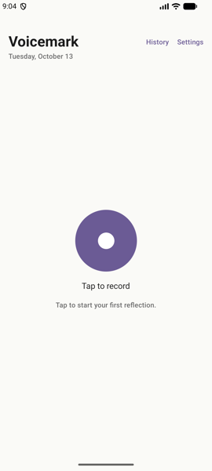
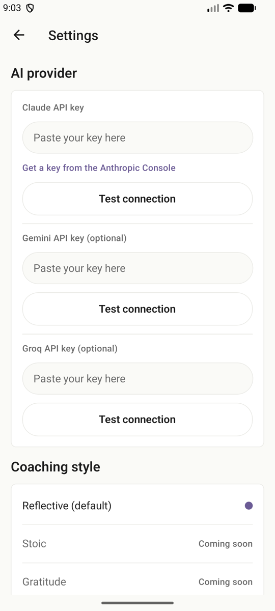

# Voicemark

**Speak. Reflect. Remember.**

<!-- Hero image: Reflection screen screenshot (Phase 5) -->

<!-- 60-second demo video (Phase 5) -->

Voicemark is a private voice journaling app. You speak a short reflection, the app transcribes it with your phone's built-in speech recognition, and Claude returns a calm three-bullet summary, one follow-up question worth sitting with, and a mood tag. Everything is stored locally on your phone — no account, no backend, no analytics.

## Features

- Voice journaling — hold or tap to record up to five minutes
- Native speech recognition (the phone's built-in recognizer; on-device when the phone has an offline model)
- AI reflection: three-bullet summary in your own voice
- One open-ended follow-up question per entry
- Mood tag from a fixed ten-word vocabulary
- Fully local storage (SQLite on device)
- Bring your own API key — your key, your quota, stored in secure storage

## Screenshots

<p align="center">
  
  &nbsp;&nbsp;
  
</p>

Left, the home screen. Right, Settings, where you add your own Claude API key.

## Privacy commitments

- Voicemark never uploads or stores your audio itself. Speech-to-text uses the phone's built-in recognizer: it runs on-device when an offline speech model is installed; otherwise the platform's speech service (Google on Android, Apple on iOS) may process the audio.
- Your transcript leaves your phone only when you tap Reflect, and only to the AI provider you connect (Anthropic Claude, with Google Gemini and Groq as optional alternatives).
- Voicemark stores no analytics. There is no backend. There is no account.
- Anthropic does not use API inputs to train its models by default. If you choose the Gemini free tier instead, Google may use your transcript to improve their models, so use a paid Gemini account if that is unacceptable for your use case.

## How to use

1. Install the APK from the latest [Release](../../releases) <!-- APK attached from v0.5.0 (Phase 5) -->
2. Paste your Claude API key in Settings
3. Hold to record

## Get a Claude API key

Go to the [Anthropic Console](https://console.anthropic.com/settings/keys) and create an API key. Copy it and paste it into Voicemark's Settings, under AI provider.

You pay Anthropic directly for what you use, and a single short reflection uses very little. If you prefer a free tier, you can add a Gemini or Groq key in the same screen instead.

## Run it locally

```bash
# Requires Node 20 and pnpm
pnpm install
pnpm dev
```

Then open Expo Go on your device and scan the QR code.

## Tech stack

Expo · React Native · TypeScript · expo-sqlite · expo-secure-store · expo-speech-recognition · Anthropic Claude API (Gemini and Groq optional)

## Roadmap

The MVP loop — record, transcribe, reflect, save, read back — is feature-complete. The post-MVP backlog includes weekly digests, mood trend charts, audio playback, Markdown/PDF export, additional coaching styles (Stoic, gratitude), and store distribution.

## License

[MIT](LICENSE)

## Author

**Aqeel Ahmad** — Senior Mobile Engineer

- GitHub: [@aqeelkhokhar](https://github.com/aqeelkhokhar)
- LinkedIn: <!-- link (Phase 5) -->
- Build write-up on Medium: <!-- link (Phase 5) -->
